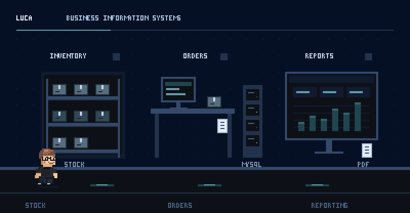

# Luca Brandao

Final-year Business Information Systems student at STADIO

<a href="mailto:lucabrandao366@gmail.com"> Email</a> &nbsp; / &nbsp; <a href="https://www.linkedin.com/in/luca-brandao-a90961352/"> LinkedIn</a>

<picture>
  <source media="(prefers-reduced-motion: reduce)" srcset="assets/systems-workshop-v3-still.png">
  
</picture>

## About me

I'm a final-year Business Information Systems student at STADIO in South Africa. I enjoy building web applications and business systems, especially where a bit of automation can make everyday work easier. My interests include inventory management, databases and reporting.

For my final-year team project, I worked as one of the lead developers on Juno Aurora Haven, building stock updates, order administration and financial reports for a children's home. I like working through requirements with a team and turning them into practical features. Outside of development, I'm usually gaming or working on a personal website.

I'm available for an entry-level opportunity from **January 2027**.

## Projects

| Project | What I worked on | Links |
| :--- | :--- | :--- |
| **Juno Aurora Haven** | Final-year project in a five-person team. Inventory updates after orders, returns and cancellations; product and order administration; income, profit and donation dashboards; PDF and Excel reports. Node.js, Express, Prisma and MySQL. | [Website](https://junoaurorahaven.org/) |
| **Wedding Website** | A predominantly static wedding website with an OurSVP integration. The public demo uses fictional event details, with responsive pages, galleries and an animated invitation. | [Demo](https://luca-brandao.github.io/Wedding-Website-Demo/) · [Code](https://github.com/Luca-Brandao/Wedding-Website-Demo) |
| **Birthday Comic** | A comic-style website with chapter navigation, a photo lightbox, bilingual controls and browser-generated audio. HTML, CSS and JavaScript. | [Demo](https://luca-brandao.github.io/Birthday-Comic-Demo/) · [Code](https://github.com/Luca-Brandao/Birthday-Comic-Demo) |

### Coursework

| Project | Focus | Source |
| :--- | :--- | :--- |
| **Cerebrum Online IT Courses** | From HTML/CSS pages to JavaScript, Bootstrap, Flask and Express APIs. | [SS1](coursework/web/cerebrum-ss1) · [SS2](coursework/web/cerebrum-ss2) · [SS3](coursework/web/cerebrum-ss3) |
| **Ubunifu Library** | Java classes, encapsulation, arrays, inheritance, collections, borrowing and returns. | [Foundations](coursework/java/ubunifu-library-ss2) · [Extended system](coursework/java/ubunifu-library-ss3) |
| **Savanna Ecosystem Simulation** | Python population modelling, random events and text reporting. | [Code](coursework/python/savanna-ecosystem) |
| **African History Quiz** | Python dictionaries, randomised questions, input validation and score tracking. | [Code](coursework/python/african-history-quiz) |

## Tech stack

**Languages**  
JavaScript · SQL · Python · Java

**Web and data**  
HTML · CSS · Bootstrap · Node.js · Express · Prisma · MySQL

**Tools**  
GitHub · Excel · Supabase · Cloudflare Pages

**AI tools**  
Claude · ChatGPT Codex

I've used Node.js, Express, Prisma and MySQL on Juno. Python, Java, SQL, Flask, systems analysis and UML form part of my coursework. My public wedding demo also uses React, TypeScript and Tailwind CSS.

## Education

**Bachelor of Business Information Systems** · STADIO Higher Education  
2024–2026 · NQF Level 7 · Nearing completion

**Certificate in Full Stack Development** · FNB App Academy  
Issued by IT Varsity · 2025

## Connect

<a href="mailto:lucabrandao366@gmail.com"> lucabrandao366@gmail.com</a> &nbsp; · &nbsp; <a href="https://www.linkedin.com/in/luca-brandao-a90961352/"> LinkedIn</a>

