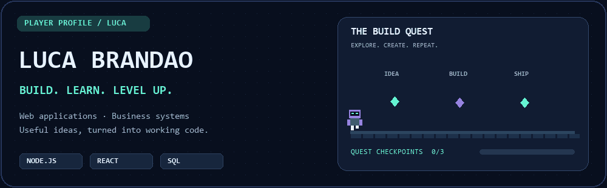
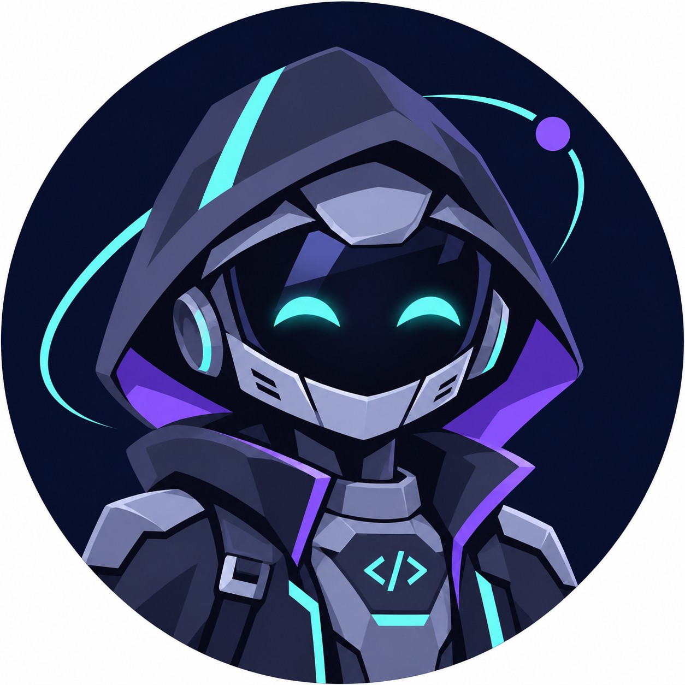
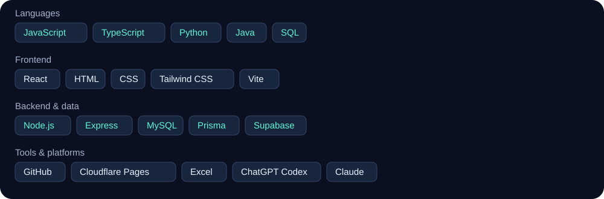

<picture>
  <source media="(prefers-reduced-motion: reduce)" srcset="assets/gaming-quest-still.png">
  
</picture>

<p align="center"><strong>Business Information Systems student · Web development · Business systems</strong></p>
<p align="center"><a href="mailto:lucabrandao366@gmail.com">Email</a> · <a href="https://www.linkedin.com/in/luca-brandao-a90961352/">LinkedIn</a> · <a href="#projects">Explore my projects</a></p>

## A little about me



I’m Luca, a final-year Business Information Systems student at **STADIO**. I like building things people can use: thoughtful web experiences, practical administration features and reports that make information easier to understand.

```javascript
const luca = {
  focus: ["Web applications", "Business systems", "Data reporting"],
  approach: "Understand the problem, build, test, improve",
  currently: "Finishing my degree and growing my project portfolio",
  nextQuest: "Turn another useful idea into working software"
};
```

## Projects

### Birthday Comic

A personal website presented as a comic book, with chapter navigation, a photo lightbox, bilingual interface controls, message cards and browser-generated audio.

**HTML · CSS · JavaScript**  
[Play the live demo](https://luca-brandao.github.io/Birthday-Comic-Demo/) · [Explore the code](https://github.com/Luca-Brandao/Birthday-Comic-Demo)

### Wedding Website

An animated invitation that opens into a responsive event website, with a countdown, story, schedule, galleries, venue information and an RSVP interface. The public edition uses fictional event content and a local RSVP preview.

**React · TypeScript · Vite · Tailwind CSS · Framer Motion**  
[Open the live demo](https://luca-brandao.github.io/Wedding-Website-Demo/) · [Explore the code](https://github.com/Luca-Brandao/Wedding-Website-Demo)

*Both public demos use invented people and event details. Original personal content is kept private.*

## Academic project experience

**Juno Aurora Haven · One of the lead developers in a five-person final-year team · 2026**

Contributed to an application for a children’s home, including stock updates after orders, returns and cancellations; product and order administration; financial dashboards; and automatic PDF and Excel reporting.

**Node.js · Express · Prisma · MySQL**

## My toolkit



Python and Java are part of my programming coursework. My projects also draw on requirements analysis, UML modelling, technical documentation and Microsoft Excel. I use **ChatGPT Codex and Claude** as development tools.

## Education

**Bachelor of Business Information Systems — in progress**  
STADIO Higher Education · 2024–2026 · NQF Level 7

**Certificate in Full Stack Development**  
FNB App Academy · Issued by IT Varsity · 2025

## Let’s connect

[lucabrandao366@gmail.com](mailto:lucabrandao366@gmail.com) · [LinkedIn](https://www.linkedin.com/in/luca-brandao-a90961352/)
