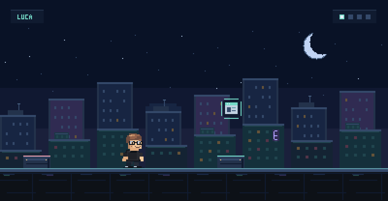

<picture>
  <source media="(prefers-reduced-motion: reduce)" srcset="assets/pixel-intro-v2-still.png">
  
</picture>

<picture>
  <source media="(prefers-reduced-motion: reduce)" srcset="assets/pixel-code-adventure-v6-still.png">
  
</picture>

##  About me

I'm a final-year Business Information Systems student at STADIO in South Africa. I enjoy web development, programming and understanding how software fits into a business. My projects range from personal websites to Python simulations, Java applications and a full-stack course platform.

For my final-year team project, I worked as one of the lead developers on Juno Aurora Haven, developing administration features and reporting for a children's home. I like working through requirements with a team and turning them into practical features. Outside of development, I'm usually gaming or spending time with family and friends.

##  Projects

| Project | What I worked on | Links |
| :--- | :--- | :--- |
| **Juno Aurora Haven** | Web application developed in a five-person team for a children's home. I contributed administration, stock automation and reporting features using Node.js, Express, Prisma and MySQL. | [Website](https://junoaurorahaven.org/) |
| **Wedding Website** | A predominantly static wedding website with an OurSVP integration. The public demo uses fictional event details, with responsive pages, galleries and an animated invitation. | [Demo](https://luca-brandao.github.io/Wedding-Website-Demo/) · [Code](https://github.com/Luca-Brandao/Wedding-Website-Demo) |
| **Birthday Comic** | A comic-style website with chapter navigation, a photo lightbox, bilingual controls and browser-generated audio. HTML, CSS and JavaScript. | [Demo](https://luca-brandao.github.io/Birthday-Comic-Demo/) · [Code](https://github.com/Luca-Brandao/Birthday-Comic-Demo) |

###  Coursework

| Project | Focus | Source |
| :--- | :--- | :--- |
| **Cerebrum Online IT Courses** | One website across three stages: HTML/CSS, JavaScript, then Flask and Express APIs. | [Repository](https://github.com/Luca-Brandao/Cerebrum-Course-Platform) |
| **Ubunifu Library** | Java library application, from classes and arrays to collections, inheritance and extended borrowing/member operations. | [Repository](https://github.com/Luca-Brandao/Ubunifu-Library-Management) |
| **Savanna Ecosystem Simulation** | Python population modelling, random events and text reporting. | [Repository](https://github.com/Luca-Brandao/Savanna-Ecosystem-Simulation) |
| **African History Quiz** | Python dictionaries, randomised questions, input validation and score tracking. | [Repository](https://github.com/Luca-Brandao/African-History-Quiz) |

The Cerebrum and Ubunifu repositories keep their development stages together, with setup instructions and a detailed README for each stage. Sample identities are fictional.

##  Tech stack

**Languages**  
JavaScript · SQL · Python · Java

**Web and data**  
HTML · CSS · Bootstrap · Node.js · Express · Prisma · MySQL

**Tools**  
GitHub · Excel · Supabase · Cloudflare Pages

**AI tools**  
Claude · ChatGPT Codex

I've used Node.js, Express, Prisma and MySQL on Juno. Python, Java, SQL, Flask, systems analysis and UML form part of my coursework. My public wedding demo also uses React, TypeScript and Tailwind CSS.

##  Education

**Bachelor of Business Information Systems** · STADIO Higher Education  
2024–2026 · NQF Level 7 · Nearing completion

**Certificate in Full Stack Development** · FNB App Academy  
Issued by IT Varsity · 2025

##  Connect

 &nbsp;&nbsp; 

